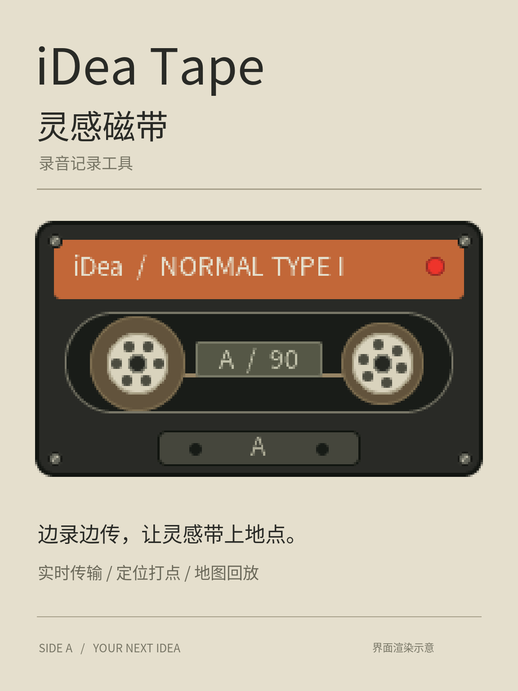

<a href="README.zh_CN.md">简体中文</a> · <strong>English</strong>

# iDea Tape — voice notes with a place to remember

Catch a passing thought on a pocket cassette, then keep its sound and starting location together on your Android phone.

**Retro device recorder + Android library + live Bluetooth reception + recording-location map.** This public open-source edition uses OpenStreetMap and contains no AMap service, map API key or proprietary map SDK.

## Project and downloads

- Complete source: https://github.com/qfx1118-oss/iDea-Tape
- Latest firmware and APK: https://github.com/qfx1118-oss/iDea-Tape/releases/latest
- Android: [iDea-Tape-Android-0.5.0.apk](https://github.com/qfx1118-oss/iDea-Tape/releases/download/v0.5.0/iDea-Tape-Android-0.5.0.apk)
- Full device firmware: [iDea-Tape-AI-Passport-0.5.0.bin](https://github.com/qfx1118-oss/iDea-Tape/releases/download/v0.5.0/iDea-Tape-AI-Passport-0.5.0.bin)
- Contact: **qfx1118@qq.com**

The complete firmware is a clean installation and **clears device settings and recordings**. Export important recordings first. See [firmware/data guidance](docs/idea-tape.md) for compatible segmented updates that preserve data. Install the same-signed APK over the old app: uninstalling removes its private recordings.

## A cassette worth carrying

Cream tones, orange labels, a red recording light, a clear timer and small Chinese hints recall an 80s/90s tape recorder. Both reels turn during recording and playback. When stopped, they coast a little farther and gently spring back. The phone also has a raised transport key: a red circle starts recording and a square stops and saves it, with pressed depth and haptic feedback.

## Record on the device, receive on the phone

After Bluetooth pairing, audio is sent to the phone while the device records. Once recording ends, the phone fills missing blocks, verifies the recording and durably saves a playable WAV. Only then does it acknowledge successful saving, allowing the device to remove its matching cache. The device shows reception state, transfer progress and completion.

Pairing, basic synchronization, locked-screen reception and automatic cache cleanup were confirmed by the user on earlier development versions. Disconnected recordings stay on the device for later backfill. Live reception does not mean unlimited recording or live monitoring of an unfinished file: playback follows final saving, and a device recording is still bounded by its cache. Missing data, failed verification, insufficient phone storage or a missing save acknowledgement must retain the device cache.

## Remember where an idea began

Optional location capture records one starting position, including coordinates and accuracy, when a new recording begins. Location comes from the connected phone; this app does not give the recorder an independent GPS receiver. Without a fresh fix, audio is saved without a position. Importing an old recording or joining midway does not attach the phone's current position as a fictitious starting point. No route is recorded.

The embedded map plots recordings matching date, favorites, search and visible-area filters. Select a marker, choose among co-located recordings and play within the app. Coordinates can also open in another map app. Recordings without a position remain in the library.

Online OpenStreetMap tiles require explicit enabling and an internet connection, but no map account or API key. Only visible tiles are requested, with caching and attribution. Map availability is best effort; if tiles fail, local markers and playback remain. There is no offline city-map download. See the [tile usage policy](https://operations.osmfoundation.org/policies/tiles/) and [attribution/license](https://www.openstreetmap.org/copyright).

## A library that grows with your ideas

Recording, Library and Map have separate entries. Favorite, search, rename, share or delete recordings; filter today, the last 7/30 days or an inclusive custom date range. Automatic names include source and date/time. Old default titles are upgraded while custom titles stay intact. Unknown device start times are labeled “imported at” rather than inventing a recording date.

The phone can record independently with its microphone, using the same library as received device recordings. Sharing defaults to audio only; including position metadata is a separate choice. No cloud account or recording upload to a map service is required.

## Quick start

1. Install the firmware and Android APK. Device recording works offline: hold UP and release to save, or press DOWN to start and again to stop.
2. On the phone, tap Connect, grant Bluetooth permission and select iDea Tape. Enter the six-digit code shown on the recorder in the Android pairing prompt. Leave the device in recording standby, outside computer export mode.
3. Record with the same buttons. The phone receives automatically; after final saving it can play the WAV and confirm cache cleanup. Enable location and wait for readiness before recording if you want a starting position.
4. Use the phone's red recording key independently, search or favorite in Library, and enable online tiles in Map to filter by time/area and play markers.
5. On the device, tap OK to browse, UP/DOWN to select and OK to play. Hold OK to return. From standby hold OK for computer export: join the displayed hotspot with its displayed password and open http://192.168.4.1 to download WAV files. Hold OK to exit.

## Requirements and verification limits

Android 8 or later; the SDK-free APK does not require Google services. See the [device guide](docs/idea-tape.md) and [Android guide](docs/android-companion.md). Build and host checks precede release. Earlier user acceptance does not imply complete physical acceptance of this new public-map APK; test map access, controls and playback on your phone. Reconnect/backfill, storage extremes and vendor power-saving behavior need more testing. Cover/gallery images are interface renders, not device photos or native phone-map screenshots.

## Development and licenses

Built on the public [FoloToy AI Passport](https://github.com/FoloToy/ai-passport) project, retaining its BSP, tools and notices. Application code is in `main/tape_*` and `main/idea_main.c`; Android source is in `android/`. Run `./tools/validate.sh` for firmware checks. The [Android guide](docs/android-companion.md) explains the standalone SDK-tool build without Gradle dependency resolution.

Source is under the repository's [MIT License](LICENSE), with upstream attribution retained. Generated Chinese font subsets use [SIL OFL 1.1](assets/fonts/OFL-NotoSansCJK.txt). Map data and tile service follow OpenStreetMap's separate attribution, licensing and usage rules. No signing private key, personal recordings, map credentials or publishing authorization is included.

Questions and contributions are welcome. Contact **qfx1118@qq.com**.

## New in 0.5.0

The Android library has date groups, clear filled favorite stars, a consistent icon family, swipe-to-reveal deletion and 8-second undo. A compact player stays available across pages. Playback, markers and filters update together after deletion. A minimal identity receipt prevents a deliberately deleted, previously saved file from reappearing through late device backfill; it contains no audio, title or location.

With both 0.5.0 components installed, enable recording location, then **Place names and device display** on the phone’s recording page. After Bluetooth connection, the phone resolves a current road name using its Android system address service and sends it to the recorder. Resolution may use the network and depends on the phone provider; unavailable addresses are labeled honestly. It does not require a proprietary map key, record routes, and can save resolved street names with each recording’s position. Disable the switch to clear the display; disconnection or expired updates clears it automatically.

The author confirmed all 0.4.0 tests passed. Version 0.5.0 has build, host and emulator checks; physical phone-to-recorder place display still needs acceptance testing.

The launcher now uses an authored retro iDea TAPE wordmark. The recording-page cassette keeps a fixed case ratio of about 1.58:1, with uniform scaling so the reels stay circular on different phones.
