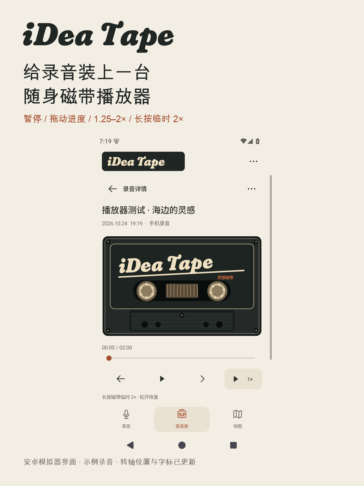

<a href="README.md">English</a> · <strong>简体中文</strong>

# 灵感磁带·录音记录工具 — iDea Tape

把一闪而过的想法录进一盘随身磁带，再把声音和地点一起留在手机里。

**设备端复古录音笔 + 安卓录音库 + 蓝牙实时接收 + 录音起点地图。** 本仓库为公开开源版：不包含高德地图服务、地图 Key 或专有地图 SDK，在线底图使用 OpenStreetMap。

## 0.6.0 更新

两端采用炭黑磁带壳、奶油色粗斜体与橙色细节。「i」的圆点融入录音提示：录音红色，待机和播放奶白。转轴上移到接近磁带中部，保持真实比例与停止后的惯性回弹。

手机录音库打开磁带播放器：播放/暂停、拖动进度、前后 10 秒、1/1.25/1.5/1.75/2 倍速；长按磁带临时 2 倍，松开恢复所选速度。地图保留简洁播放。左滑删除图标已居中，撤销显示 5 秒倒计时。

设备 30 秒无按键自动息屏，录音和蓝牙继续运行；首次任意键只亮屏，再按才操作。手机减少空闲蓝牙、定位、缓存落盘和不可见动画开销。节电与降温幅度尚未测量，不承诺全天续航。

## 下载与项目

- 完整项目：https://github.com/qfx1118-oss/iDea-Tape
- 最新安装包与固件：https://github.com/qfx1118-oss/iDea-Tape/releases/latest
- 安卓安装包：[iDea-Tape-Android-0.6.0.apk](https://github.com/qfx1118-oss/iDea-Tape/releases/download/v0.6.0/iDea-Tape-Android-0.6.0.apk)
- 设备完整固件：[iDea-Tape-AI-Passport-0.6.0.bin](https://github.com/qfx1118-oss/iDea-Tape/releases/download/v0.6.0/iDea-Tape-AI-Passport-0.6.0.bin)
- 保留设备数据：[分段升级包](https://github.com/qfx1118-oss/iDea-Tape/releases/download/v0.6.0/iDea-Tape-Preserving-Upgrade-0.6.0.zip)
- 联系邮箱：**qfx1118@qq.com**

设备完整固件用于从零安装，**会清除原有设备设置和录音**，请先导出重要录音。已有兼容版本需要保留数据时，见[构建与数据说明](docs/idea-tape.zh_CN.md)。手机请同签名覆盖安装，不要先卸载；录音保存在 App 私有目录，卸载会删除。

## 为什么是一盘磁带

奶油色机身界面、橙色标签、红色录音点、清楚的时长和中文小字提示，保留八九十年代磁带录音笔的感觉。录音和播放时，两只转轴会转动；停止时先多转一点，再轻轻回退，模拟机械惯性。手机的录音键也采用实体磁带按键造型，用红色圆点与停止方块代替按钮上的文字。

## 边录边传，手机接住灵感

安卓手机与设备通过蓝牙配对后，设备录下的音频会边录边传到手机。录音结束后，手机补齐缺失片段、校验并保存为可播放的 WAV；确认保存成功后，设备才删除对应缓存。设备屏幕显示实时接收状态、传输进度和完成提示。

锁屏接收、配对、基本同步与自动清理已在前序开发版获得用户实测确认。蓝牙断开时，设备继续保留未同步录音，重新连接后按已有进度补传。**实时传输不等于无限录音，也不表示手机可以在录音未结束时立即试听该段音频**：完整文件在结束并保存后回放，设备录音仍受缓存容量限制。手机空间不足、校验失败或确认未完成时，不会仅因“发过数据”就自动删除设备缓存。

## 给每段录音留下起点

开启可选定位后，手机会在新录音开始时记录一次位置，保存经纬度和精度。设备本身没有在此玩法中独立采集 GPS；位置来自连接的手机。没有及时定位时，录音照常保存、位置留空。旧录音补传和中途连接不会用导入时的位置冒充录音起点。不记录路线轨迹。

地图页显示符合条件的录音标记，可按日期、收藏、搜索内容和当前地图区域筛选。点标记后可选择该位置的录音并在 App 内播放，重叠位置也能选择具体录音；仍可用其他地图打开坐标。没有位置的录音继续留在录音库中。

OpenStreetMap 在线底图需要首次明确开启，不需要地图服务账号或 API Key。仅请求当前可见区域，带署名与缓存；底图可能受网络或服务可用性影响，失败时保留录音标记和本机回放。它不提供离线城市地图包。参见[图块使用规则](https://operations.osmfoundation.org/policies/tiles/)和[地图数据署名](https://www.openstreetmap.org/copyright)。

## 录音多了，也能找得到

手机分为“录音、录音库、地图”三个入口。录音可收藏、搜索、命名、分享；支持今天、近 7/30 天及自选日期范围。自动名称包含来源与日期时间，例如“手机录音 年-月-日 时-分-秒”；旧的默认名称会更新，手动命名保留。开始时间未知的旧设备录音明确使用“导入于”，不编造记录日期。

手机也能独立录音：不连接设备，点红色圆点开始、点方块结束保存，与设备接收的录音共用同一个库。分享默认只包含音频，附带位置资料需要另行选择。无需云账号，不上传录音到地图服务。

## 快速上手

1. 安装固件和安卓 APK；离线录音无需配网。设备按住上键录音、松开保存，或按下键开始、再按结束。
2. 手机点“连接灵感磁带”，允许蓝牙权限，选择 iDea Tape，在手机配对窗口输入设备屏幕上的六位码。保持设备在录音待机，退出电脑导出模式。
3. 按原按键录音，手机自动接收。保存完成后可在录音库回放，设备才清理缓存。需要记录起点时先开启定位，并等定位就绪。
4. 手机红色录音键可独立录音；在录音库搜索、收藏，在地图开启在线底图，按时间或当前区域筛选并点标记播放。
5. 设备短按 OK 选音频，上下选择、OK 播放；长按 OK 返回。待机长按 OK 进入电脑导出，按屏幕热点与密码连接，用浏览器打开 http://192.168.4.1 下载 WAV，完成后长按 OK 退出。

## 说明与验证边界

- 安卓 8 及以上；这份无专有 SDK 的 APK 不依赖 Google 服务。
- 设备按键详见[设备说明](docs/idea-tape.zh_CN.md)，手机权限、保存和隐私详见[安卓说明](docs/android-companion.zh_CN.md)。
- Build 与 Host tests 在发布前检查；前序版本已实测的功能不等于本次开源地图 APK 全部获得真机验收。首次使用请核对地图联网、按键和录音回放。断线补传、极端存储及各品牌后台限制仍需更多实测。
- 封面和配图是应用界面渲染示意，不是实机照片或手机地图截图。

## 开发与许可

本应用在 [FoloToy AI Passport](https://github.com/FoloToy/ai-passport) 的公开项目基础上开发，保留上游 BSP、开发工具与许可证。应用逻辑位于 `main/tape_*` 和 `main/idea_main.c`，安卓源码位于 `android/`。固件使用仓库的 `./tools/validate.sh` 完整验证；安卓无需 Gradle 依赖解析，构建方法见[安卓说明](docs/android-companion.zh_CN.md)。

源码采用仓库 [MIT License](LICENSE)，保留上游版权声明。生成的中文字体子集采用 [SIL OFL 1.1](assets/fonts/OFL-NotoSansCJK.txt)；地图数据和图块另遵循 OpenStreetMap 的署名、许可与服务规则。签名私钥、个人录音、地图密钥及社区/GitHub 授权凭据不在仓库中。

欢迎提出问题、提交改进或通过 **qfx1118@qq.com** 联系作者。

## 录音库与地点显示

手机录音库按日期分组，使用统一图标和清晰的实心收藏星标。左滑录音后点垃圾桶删除，5 秒倒计时内可撤销；详情页和更多菜单也能删除。播放、地图标记和筛选结果会同步更新。极简文件识别凭据可防止已主动删除、此前已保存的录音被设备延迟补传重新导入，凭据不含音频、标题或位置。跨页面可使用底部迷你播放器。

设备和手机均更新至 0.5.0 或更新版本后，在手机录音页先开启“录音起点定位”，再开启“地点名称与设备显示”。蓝牙连接后，手机通过系统地址服务解析当前道路名，推送到录音笔屏幕。地址解析可能联网，取决于手机系统服务；失败时显示地址不可用，不需要地图 Key，不记录路线，录音库会按各录音保存的坐标解析并保存地点名，替换“有位置”，不会套用手机当前地点。关闭开关会清除设备地点；断开连接或更新过期后自动清除。

作者已确认 0.4.0 全部测试通过。0.5.0 设备界面及手机到设备的道路名显示已由作者确认。0.6.0 构建、主机、安卓模拟器检查和设备启动通过；息屏后的音频与蓝牙连续性、按键唤醒、温度和续航仍待实测。

桌面图标更换为复古手写感 iDea TAPE 字标；录音页磁带外壳按约 1.58∶1 比例显示并保持等比缩放，转轴在不同手机上仍为圆形。
